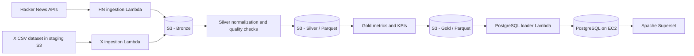
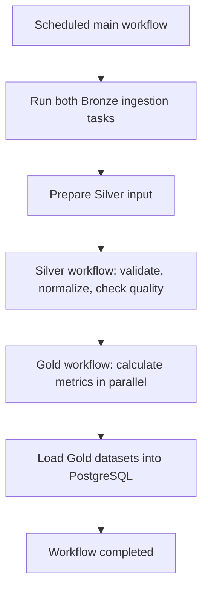

# Cloud Project - AWS Social Media Data Pipeline

An AWS-based data engineering project developed for the **Cloud Computing** course at the Faculty of Technical Sciences, University of Novi Sad.

The system collects data from **Hacker News** and **X (Twitter)**, processes it using a **Medallion architecture**, calculates analytical metrics and data quality indicators, and makes the results available to **Apache Superset** through **PostgreSQL**.

## Team

- [Branislav Marković](https://github.com/bane-31)
- [Nikola Savić](https://github.com/nikolasa004)
- [Uroš Milinović](https://github.com/UrosMilinovic)

## Overview

The platform is organized as a multi-stage data pipeline:

1. **Bronze:** collect source data and store it in Amazon S3.
2. **Silver:** clean and normalize records into shared post and user schemas, stored as Parquet datasets.
3. **Gold:** calculate daily statistics, rankings, and data quality metrics.
4. **Serving:** load analytical datasets into PostgreSQL for visualization in Apache Superset.

Separate AWS Lambda functions implement the individual processing steps. **AWS Step Functions** orchestrates the pipeline, while **CloudWatch alarms, Amazon SNS, and a Discord notification Lambda** provide failure notifications.

## Architecture



### Workflow orchestration

The main Step Functions state machine coordinates three processing stages. Independent tasks within the Bronze, Silver, and Gold stages run in parallel where appropriate.



The workflow definitions include retries and error handling. Separate CloudWatch error alarms can publish failures to SNS, which triggers a Lambda function that sends notifications to Discord.

## Data sources

### Hacker News

The Hacker News ingestion Lambda collects items from the **previous UTC day**. It uses Hacker News and Algolia endpoints to retrieve stories, comments, jobs, and polls, including Ask HN content. Collected records are stored as JSON in the Bronze layer.

### X (Twitter)

The X integration uses a **pre-existing CSV dataset**, not the live X API. The ingestion Lambda reads the source file from an S3 staging bucket, selects records for a target date, and stores the selected CSV data in the Bronze layer. This allows the X source to participate in the same processing pipeline without requiring paid API access.

The two sources can represent different historical dates; the workflow passes the relevant dates into subsequent processing stages.

## Processing layers

### Bronze - Raw ingestion

The Bronze layer retains the source records for subsequent processing. Hacker News data is stored as JSON, while the selected X dataset records are stored as CSV.

Example S3 prefixes:

```text
bronze/
├── hackernews/
│   └── date=YYYY-MM-DD/
└── x/
    └── date=YYYY-MM-DD/
```

### Silver - Normalization and validation

Four specialized Lambda functions normalize Hacker News and X posts and users into common schemas. Their processing includes:

- timestamp conversion to a consistent UTC representation
- cleaning and standardizing text fields
- removal of duplicate records
- mapping source-specific fields to common post and user columns
- validation of required columns and non-empty datasets
- writing partitioned Parquet datasets to S3

The Silver workflow validates Bronze inputs, runs the four normalizers in parallel, and performs quality checks on their outputs.

### Gold - Analytics

The Gold layer produces five analytical datasets:

| Dataset | Purpose |
| --- | --- |
| `daily_activity_metric` | Daily Hacker News counts for stories, Ask HN posts, comments, jobs, and polls |
| `daily_users_metric` | Total and new user counts for Hacker News and X within the processed data |
| `top_authors_metric` | X users ranked by followers and Hacker News users ranked by highest and lowest karma |
| `top_posts_metric` | Top Hacker News jobs and stories ranked by score |
| `data_quality_kpi` | Percentage of records with populated required fields, by dataset and source |

The individual transformations write their results as partitioned Parquet datasets in S3. A separate loader reads the Gold datasets and writes them to PostgreSQL.

## Visualization

The serving layer is designed around **PostgreSQL** and **Apache Superset**, hosted on an **Amazon EC2** instance using Docker containers. PostgreSQL holds the processed analytical tables, allowing Superset to query the results and build charts and dashboards without reading Parquet files directly from S3.

The repository includes infrastructure definitions and supporting Superset setup scripts. The AWS environment used for the course project is not maintained as a publicly accessible live deployment.

## Infrastructure and monitoring

The project includes Infrastructure as Code definitions using **CloudFormation** and the **Serverless Framework**, covering:

- **Amazon S3:** data lake and staging buckets
- **AWS Lambda:** ingestion, normalization, metrics, loading, and notifications
- **AWS Step Functions:** scheduled orchestration and parallel processing
- **Amazon EC2:** PostgreSQL and Superset hosting
- **Amazon VPC:** public/private subnets, routing, NAT gateway, security groups, and an S3 gateway endpoint
- **Amazon CloudWatch and SNS:** Lambda error alarms and notification delivery

The Discord notification function is triggered by SNS messages and formats AWS alarm details for the project team.

## Repository structure

```text
.
├── bronze/           # Hacker News and X ingestion Lambdas
├── silver/           # Normalizers, shared schemas, and quality checks
├── gold/             # Analytical transformations and PostgreSQL loader
├── orchestration/    # Main Step Functions workflow and input preparation
├── infra/            # S3, VPC, and EC2 infrastructure definitions
├── notifications/    # SNS-to-Discord notification Lambda
├── serving/          # Apache Superset setup resources
├── docs/             # Architecture, data flow, and AWS setup notes
└── README.md
```

Each processing component is organized independently, with its own source code and deployment configuration where applicable.

## Deployment notes

The implementation targets **AWS `eu-central-1`** and uses **Python-based Lambda functions** with **Serverless Framework v3** configurations. A deployment requires an appropriately configured AWS account, permission to create the required resources, a staged X dataset, and environment-specific configuration for services such as PostgreSQL and notifications.

Infrastructure, Lambda functions, and Step Functions workflows are defined in separate stacks, with dependencies between them. The project therefore is **not intended to run as a single local command**. Some configurations contain course-environment-specific resource names and must be reviewed before redeployment. Secrets and credentials should be provided through secure configuration, not reused from example files or committed values.

## Project context

This is a team course project demonstrating the integration of **serverless data processing, workflow orchestration, data engineering, infrastructure provisioning, and analytical visualization** into a single AWS-based system. The repository preserves the implementation and configuration developed for the assignment, rather than a permanently hosted production service.
